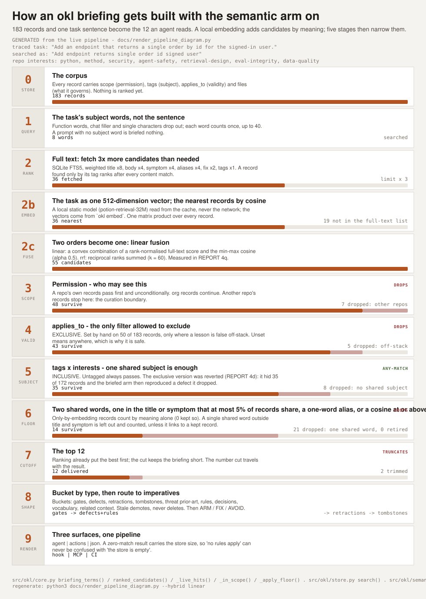

<!-- mcp-name: io.github.emeraldleaf/okl -->
<div align="center">

<picture>
  <source media="(prefers-color-scheme: dark)" srcset="https://raw.githubusercontent.com/emeraldleaf/okl/main/docs/brand/okl-logo-dark.png">
  
</picture>

# okl — Observed Knowledge Ledger

**Keeps your coding agent true to your rules, specs and docs. Keeps them true to the code. Keeps learning as you build.**<br>
It guards against drift both ways: your agent drifting from your rules, and your rules, specs
and docs drifting from the code.<br>
Your rules, architecture decisions, past defects, documentation and diagrams: recorded once,
briefed to your agent before every task (by a hook in Claude Code; any MCP agent can ask for
the same briefing), each proven by a check you choose, flagged before you push (or in CI) when
what it covers changes, and corrected or retired as you build. Prompts advise; the gate
enforces. Use it in one repo, or share one store across every repo your team runs.<br>
Under the hood: typed records, keyword search and one-step links. No model runs by default,
no generative model ever, no automatic capture. Three local models are optional, measured and
off until you turn them on: an embedding arm, a reranker and `okl warm`
([REPORT §4q, §4t, §4z](evals/REPORT.md)). A lesson is written
on purpose and proven by a check. The claim in full, how much of it holds today and how it
has changed: [docs/THESIS.md](docs/THESIS.md).

[](https://pypi.org/project/observed-knowledge-ledger/)
[](pyproject.toml)
[](https://github.com/emeraldleaf/okl/actions/workflows/ci.yml)
[](https://github.com/emeraldleaf/okl/actions/workflows/okl-verify.yml)
[](#install-as-a-claude-code-plugin)
[](LICENSE)

🚀 [Quickstart](#quickstart) · 📘 [Getting started](docs/GETTING-STARTED.md) · 📥 [Load your rules](docs/LOAD-YOUR-RULES.md) · 🔬 [How it works](#how-it-works) · 📊 [Results](#measured-effect-and-its-limits) · 🧪 [Eval report](evals/REPORT.md) · 🧩 [Plugin](#install-as-a-claude-code-plugin)

</div>

```bash
pipx install 'observed-knowledge-ledger[mcp]'   # the command it installs is `okl`
okl init --repo my-repo                         # hooks, MCP server, push gate, starter lessons
```

**42% → 7%.** On eight tasks written to invite defects the store already knew about, 68 of 163
unbriefed attempts repeated one against 11 of 164 briefed, pooled over seven A/B runs with a
different model judging than generating ([the receipts](evals/REPORT.md), §5 finding 7). Small
sample, one-shot code on bait tasks; [what it does and does not show](#measured-effect-and-its-limits).

<picture>
  <source media="(prefers-color-scheme: dark)" srcset="https://raw.githubusercontent.com/emeraldleaf/okl/main/docs/overview/okl-overview-dark.png">
  
</picture>

## What goes wrong, and what catches it

| When | What okl does |
|---|---|
| The agent is about to repeat a defect you already paid for | the briefing puts the lesson in front of it before the task, selected by the task's words |
| Code a lesson covers changes after its last check | `okl drift` goes red; the pre-push hook holds the push (or CI fails) until the check passes again or the code is back to what passed; the next briefing marks the lesson STALE |
| A lesson turns out to be wrong | `okl retire --reason` keeps it, briefed as AVOID so nobody restates it; nothing is deleted |
| A lesson is replaced | `okl retire --by <new-id>`; the briefing points to the replacement |
| The store cannot be reached | the Claude Code hook blocks the prompt and says why; the MCP tool says it was not briefed. Never a clean "no rules apply" |
| A session changed files and recorded nothing | the Claude Code Stop hook asks once what was learned, and names the lessons the session touched |

## Quickstart

> New here? **[docs/GETTING-STARTED.md](docs/GETTING-STARTED.md)** walks through setup and the
> habit of adding lessons as you build a feature. Already have a `CLAUDE.md`, ADRs, standards or
> specs? **[Load your rules](docs/LOAD-YOUR-RULES.md)** shows how to load them, prove the ones
> that matter, and keep them current.

**1. Install the CLI.** Python 3.11+ (0.8.9 is the last release for 3.10), git for drift.
macOS and Linux; Windows is untested
([#85](https://github.com/emeraldleaf/okl/issues/85)).[^name]

```bash
pipx install 'observed-knowledge-ledger[mcp]'
```

**2. Wire your repo**, from its root:

```bash
okl init --repo my-repo --dry-run   # lists every file it would write; writes nothing
okl init --repo my-repo             # config, Claude Code hooks, MCP server, pre-push drift gate, starter lessons
```

`init` detects your stack (`*.csproj`, `package.json`, `pyproject.toml` …), sets the repo's
interests from it, and fills the store with 20 starter lessons that hold on almost any
codebase plus the bundled packs for your stack, so the first prompt is already briefed
(`--interests` chooses your own subjects; `--no-seed` leaves the store empty). It wires Claude
Code when the repo has a `.claude/` directory or `claude` is on your PATH (`--claude` /
`--no-claude`), installs a pre-push hook that blocks a push only when lessons have drifted
(`--no-git-hook` skips it; `--ci` installs the GitHub workflow instead, `--ci --git-hook` both),
and remembers both choices. Every path it writes, and what each is for:
[What `okl init` writes](docs/WHAT-INIT-WRITES.md).

**3. Add a rule of your own.** The starter lessons are generic; what pays is what only your
codebase knows. Tell your agent — *"record an okl rule for this repo: order lookups are
scoped to the signed-in customer; governs app/orders.py"* — and it records the lesson with
okl's `okl_record` MCP tool (in Claude Code, `/record` drafts it and asks you first).
Underneath, that is one CLI call you can also run yourself:

```bash
okl record --type Rule --scope repo --id order-owner-scope \
  --title "Order lookups are scoped to the signed-in customer" \
  --symptom "an endpoint fetches an order by id with no owner filter" \
  --fix "filter by the caller's customer id in the query; return 404 on no match"
```

Then prove it: `okl verify order-owner-scope --run "pytest -q tests/test_orders.py" --expect passed`.
Loading the rules, ADRs and specs you already wrote, and the bundled packs, is
[Seed it](docs/SEEDING.md).

**4. Check it works:**

```bash
okl check --task "add an endpoint that returns an order for the logged-in user"
okl doctor                  # flags other memory tools, double wiring, and where drift is gated
```

[^name]: The PyPI name differs because PyPI refuses `okl` as confusable with `oki`; everything you type afterwards is `okl`.

### Which agent, which part

| | Claude Code | Any MCP agent (Cursor, Codex, Copilot …) | Any agent, or none |
|---|---|---|---|
| Briefing before each task | a hook on every prompt, automatic, fails closed | the `okl_check` tool, when the agent calls it | `okl check` in the terminal or a script |
| Recording what was learned | the Stop hook asks once per session that changed files | the `okl_record` tool | `okl record` |
| Proof and drift | `okl verify`, `okl reverify`, `okl drift` | the same commands | the same commands |
| The gate | the pre-push hook | the pre-push hook | the pre-push hook, or the CI workflow (`okl init --ci`) |

The hooks are Claude Code's; everything else is a command or an MCP tool and works anywhere.
Setting up another agent: [Getting started](docs/GETTING-STARTED.md#using-another-agent).

## What a normal day looks like

- **You prompt as usual.** In Claude Code, the pre-task hook runs `okl check` on what you typed and puts
  the relevant lessons in the agent's context before it starts, and shows you one line —
  *okl · briefed 9 lesson(s): …* — so you can see it working (`OKL_QUIET=1` hides it).
- **When you learn something worth keeping** — a decision, a convention the agent broke,
  a bug you fixed — say so and the agent records it (`okl_record`, or `okl record`), with
  the files it governs. In Claude Code the Stop hook also asks once, at the end of a
  session that changed files, what was learned, and names the lessons the session was
  briefed on and those whose files it changed, so the agent can propose correcting or
  retiring one (you approve).
- **Using another agent?** The briefing and recording are MCP tools (`okl mcp`); register
  them and add one line to your `AGENTS.md`: *before each task call `okl_check`*. The hooks
  that do this automatically are Claude Code's; see
  [Getting started](docs/GETTING-STARTED.md#using-another-agent).
- **When a lesson needs correcting,** take its `[id]` from the briefing and change only
  what is wrong: `okl update <id> --fix "..."` (or the `okl_update` tool) keeps the rest,
  including its proof, unless you change its governed `--files`: then it needs verifying
  again, and `okl reverify` re-runs its stored check. `okl show <id>` prints the whole
  lesson, with how often its check has passed and failed: every run of `okl verify` and
  `okl reverify` is kept, so a check that caught a change leaves a record. Recording an
  existing id again is refused, because it used to replace the lesson and wipe its proof.
- **When a lesson is wrong or replaced,** retire it with a reason; nothing is deleted.
  `okl retire <id> --reason "..."` keeps a wrong one briefed as AVOID, so nobody restates
  it; `--by <new-id>` takes a replaced one out of briefings, which point to the new one;
  `--obsolete` is for a lesson whose subject is gone. A fixed defect is not retired: it
  keeps briefing against its return.
- **Proving a lesson is true** is a check you run, not a flag you set:
  `okl verify <id> --run "pytest -q tests/test_orders.py" --expect "passed"`.
- **When code a lesson governs changes,** `okl drift` goes red until its check passes
  again, or the code is put back as it was when the check passed (a lesson recorded
  with `--files` is also red until its first `okl verify`). The briefing says so too:
  such a lesson is marked *STALE* (or *UNVERIFIED*, or *UNPROVEN*) with the file
  that changed, so the agent confirms it against the code instead of trusting it blindly.
  A lesson that governs no files here, and was never verified or carries a stamp with no
  `okl verify` run behind it, is marked *UNCHECKED*; drift has no verdict on it, so nothing
  else would say so. The agent treats it as advice, and one line under the briefing says how
  many there are.
  `okl reverify` re-runs each drifted lesson's stored check after you confirm. Drift notices
  that what a lesson watches changed; it does not find every break. Of 52 patches written to
  break the lessons it watched in this repo, a judge confirmed 36 as breaks, and drift caught 14
  of those 36; most of the misses changed a file one step from the ones the lesson watches
  (REPORT §4af). So list every file a lesson's claim
  depends on, and read a green drift as "nothing it watches moved". With the
  GitHub workflow (`okl init --ci`), CI reads a committed snapshot, `okl-drift.json`, which
  `okl verify` creates the first time a lesson with `--files` is verified and keeps current
  after that: commit it after the code change it verifies. Until then CI warns "Drift not
  checked", which is expected. Without the workflow, `okl verify` writes no snapshot unless
  one is already committed.
- **Headless runs** (`claude -p`, scripts, CI agents) set `OKL_DISABLED_HOOKS=encode`,
  or the end-of-session question replaces the printed answer.


## The problem it solves

A team, or an agent, fixes a subtle bug, learns why it happened, and writes a rule to prevent
it. Weeks later, in a different file or a different repository, the same class of bug comes
back, because the person or agent doing the new work never saw that rule. The knowledge
existed; it was not in front of whoever needed it, at the moment they needed it. And when it
was, it was often out of date: the code it described had moved on.

okl answers both. **The relevant lessons are read automatically at the start of a task, not
looked up if someone remembers to**, and **a lesson stays true or goes stale loudly**: each is
proven by a check you choose and re-opened when the code it covers changes.

**This is a v0 starter, not production-hardened.** It ships an end-to-end test suite (`pytest -q`
shows the suite and its result in your environment). The core is stdlib-only with zero
required dependencies.

## What okl is

**A store of your engineering lessons, and the machinery that keeps them true.** Typed
records (rules, architecture decisions, known defects, gates, tombstones, retractions) that
are briefed into an agent's context before a task and go stale loudly when the code they
describe moves on. Everything measured in [evals/REPORT.md](evals/REPORT.md) measures this.

It is worth being precise about what that store fills up with, because "lessons a
codebase has learned" invites the picture of a bug database. In the 183-record corpus
in [seed/](seed/) it is mostly not that: **110 Rules, 20 Decisions and 7 Gates against
36 Defects** — conventions the code follows and trade-offs already settled, not a
ledger of things that broke. Count it yourself:

```bash
python3 -c "import json,glob,collections; c=collections.Counter(
  n['type'] for f in glob.glob('seed/*.json') for n in json.load(open(f))['nodes']); print(c)"
```

A second, optional thing ships in the package: [`okl scaffold`](docs/SCAFFOLD.md), a starter
kit for the in-repo discipline the store assumes (a lean rules file, mechanical gates, a
review agent, an eval harness). It has never been measured; use it to get a new repo to the
state where a store has something to attach to.

## What okl is not for

okl holds lessons: what an agent would see or do (the symptom), what to do instead (the
fix), why, and where it can be proven, the check. Most of a good agent setup is other
things, and they work better elsewhere:

| If it is… | Put it in | Why not okl |
|---|---|---|
| a rule every session needs, whatever the task | `CLAUDE.md` / `AGENTS.md` | those load in full every time; a briefing picks lessons per task |
| a procedure: how to release, migrate or set up | a skill, runbook or script | a procedure is read whole and in order; a briefing hands over a few short records |
| commands, and "for X, read Y" pointers | `CLAUDE.md` / `AGENTS.md`, or a skill | it is a map the agent needs on every relevant task |
| formatting and code style | a formatter or linter | a tool enforces it on every line; a lesson can only remind |
| a bug that is still open | your issue tracker | the tracker owns open work; okl keeps what was learned once it is fixed |
| secrets, credentials, personal data | nowhere near okl | the store is shared and its lessons are copied into agent context |

Everything with a symptom and a fix belongs here: a convention the code follows, a decision
made on purpose, a defect class you have already paid for. The
[getting-started guide](docs/GETTING-STARTED.md#store-records-vs-claudemd--agentsmd) has
the same split from the side of recording.

## What it keeps from drifting, and how

Knowledge rots in a specific way: the code changes and everything written *about* the
code silently stops being true. Each row below catches a different version of that, and
it is worth knowing which one catches what, because they do not overlap.

| Drift | Caught by | How it works | Fires when |
|---|---|---|---|
| **A rule vs. the code it governs** | `okl drift --gate` | a record declares the path globs it governs, and `okl verify` records the commit its check passed at | those files differ between that commit and HEAD (a verification with no recorded commit, or one this clone lacks, compares commit times instead) — or the rule has never been verified at all, so a new `--files` rule is red until its first `okl verify` — or its stamp has no observed check behind it |
| **A retired identifier reappearing in prose** | `check-tombstones.sh` | greps the working tree's source, docs, comments and config for every tombstoned name | any non-allowlisted hit |
| **A withdrawn claim being restated** | `check-retractions.sh` | greps the working tree's markdown for the exact quoted claim from the retraction registry | the quote appears outside the registry |
| **A doc nobody links to** | `check-doc-orphans.sh` | checks that each top-level `docs/` doc or image is named by a hub file or a `docs/*.md` (one hop, not transitive) | nothing names it, so it drifts unread |
| **A link pointing at a file that moved** | `check-links.sh` | reads every markdown file listed by `git ls-files` and checks each local link's target exists in the working tree | the target does not exist |
| **A diagram source with no rendered image** | `check-diagram-pairs.sh` | pairs each editable source with its export; format-agnostic via `OKL_DIAGRAM_SRC_EXT`/`OUT_EXT` | reviewers would see nothing. A hand-authored image with no source is noted, never failed, and a repo with no diagram sources is a clean no-op |
| **Verification going quietly stale** | TTL + `verified_by` | records carry when they were last verified and by which observed check; a TTL applies only to records given `--ttl-days` (none by default) | past its TTL, a record is shown demoted rather than deleted |

Three honest limits on that table:

- **Diagram *content* is still a human job.** `check-diagram-pairs.sh` proves the rendered
  image exists; nothing proves it matches the source it was exported from, or that either
  matches the code. For that, name the diagram in a record's `--files` alongside the code
  it depicts, so changing the code turns the drift gate red until someone re-verifies the
  picture. This repo holds its README that way; its pipeline diagram is generated from the
  code instead, and a test fails when the committed render no longer matches.
- **Comments are covered only by the tombstone gate.** It finds a retired name in
  `.md`, `.py`, `.ts`, `.tsx`, `.cs`, `.yaml`, `.yml`, `.json` and `.sh` files; the
  retraction gate reads markdown only. Any other stale comment is not caught, and
  `okl reverify` re-stamps a governed file without reading its comments, so a check has
  to test the claim a comment makes for drift to mean anything.
- **`okl drift` only watches what a record claims.** A file no record governs is not
  watched by anything. Coverage is a curation decision, and the gap is invisible until
  something breaks — which is why the mechanical gates above scan the whole repo (the
  tombstone and retraction gates grep the working tree) rather than only what is enrolled.


## How okl differs

- **From memory layers** (mem0, Zep, Letta, the Claude Code memory plugins): they recall what
  the agent experienced; okl keeps what must stay true, and proves it with a check you chose.
- **From rules files** (`CLAUDE.md`, `AGENTS.md`): a briefing selects the few lessons that
  match the task; a rules file loads whole, every time, and nothing re-checks it.
- **From instruction-file linters**: they check that a path or command a rules file names still
  exists; okl runs your check, and blocks the push when its code moved.
- **From documentation platforms**: they draft and review; okl drafts nothing and blocks a push.

| | Best for | The trade |
|---|---|---|
| A rules file | the five rules every session needs | loaded whole; no proof, no per-task selection |
| A memory layer | recall over what an agent has seen | a model's judgment at use time; nothing tied to your check or your push |
| okl | lessons with a symptom, a fix and a check | you write them on purpose, and keep them proven |

The long version, with the comparison table and how to run okl beside another memory tool:
[Where this sits](docs/WHERE-THIS-SITS.md). It fails closed by design: an unreachable store
blocks or warns, never reports "clean".

What the research literature measured in 2026, with figures read from the papers and a
"where okl stands" column beside each result: [Related work](docs/RELATED-WORK.md).

## Measured effect, and its limits

One held-fixed A/B (8 authored tasks, 3 samples per arm per run; generator and blind
judge are different models; method + raw receipts in [evals/REPORT.md](evals/REPORT.md)):

- Same model, briefed vs not: in the first 3-sample runs (2026-08-30), defect
  reproduction fell **33% → 4%** (sonnet) and **38% → 12%** (haiku). Later sonnet runs, as
  the retrieval pipeline changed, read **35–50% → 4–8%** (REPORT §4b–§4i, excluding the
  reverted §4d and the opus-judged §4f; the latest, §4i, 43% → 8%). Pooled over the seven
  runs on that instrument from §4 to §4h, the reverted §4d included: **68 of 163 unbriefed
  attempts repeated a known defect (42%) against 11 of 164 briefed (7%)**; REPORT §5
  finding 7 names the receipts and the other ways to cut it. The unbriefed arm
  alone has moved 21 points between runs with nothing changed, and 26 across the §4j
  boundary, so the noise floor is at least 21 points (§2b, §4m). Every "reproduced" is a
  defect class this store had already paid to learn — a
  price-tamper fallback, tokens in web storage, an unpinned CI gate, a script that trusts
  exit 0 without checking its output, an eval summary that does not put its failure
  rate first — not lint noise. Two tasks (an IDOR endpoint, a React fetch) have never
  reproduced without the briefing in any committed receipt (46–48 unbriefed samples each),
  so they cannot show a reduction; the rate limiter has reproduced 1 of 41 times without
  the briefing (§4m) and 2 of 44 with it (REPORT §4d, §4m, §5 finding 6).
- The result worth remembering, from those first runs: **briefed haiku (12%) beat
  unbriefed sonnet (33%)**. It suggests the briefing is a cost lever, not just a quality
  lever — it can hold a cheaper model above a frontier model's unbriefed floor on the
  org's known failure modes. Two caveats: the haiku run was never repeated, and it was
  judged by sonnet where the sonnet runs were judged by haiku.
- Every run above predates the briefing's **Decisions** section: until recently a
  Decision that won a slot was silently dropped; it now appears under its own heading.
  No eval task's briefing held one, so the eight measured briefings are byte-identical
  either way.
- Every run above also predates the **`[id]`** each briefed lesson now carries. That one
  is not byte-identical: the eight eval briefings are 5% larger, with every lesson's
  content kept (REPORT §4j). Its run (2026-10-10) read **17% → 0%**, but the unbriefed arm
  itself fell 26 points from §4i's, which points at the generator rather than okl, so it
  starts a new series and is not pooled with the runs above.

The figure is also a transfer result. The eight tasks are fresh code written from a task
prompt, and the defect classes they invite were learned in other projects: each task names
its lesson in [evals/tasks.jsonl](evals/tasks.jsonl), and those lessons arrive through six of
the twelve seed packs. A lesson paid for in one project prevented the defect in code written
for another. In the pooled runs the briefing held each task's lesson with three exceptions,
whose arms measure the briefing without it: `exit_code_trust`'s ranked below the twelve-record
cutoff in every run until the lesson gained a symptom on 2026-10-22 (REPORT §4b, §4o);
`rate_limiter`'s was filtered out in the reverted §4d run; and `react_fetch`'s was filtered
out in the two runs made with this repo's declared interests (§4h). Running that across an organisation, and what it asks of a lesson, is
[Across an org](docs/ACROSS-AN-ORG.md).

What this does **not** show: the tasks were authored to invite defect classes the store
encodes, so it measures what a briefing does when a directly relevant lesson exists —
not general code quality, and not retrieval at scale. n is small; treat it as a pilot
with receipts, not a benchmark.


## How it works

The overview at the top is rendered from
[`docs/overview/okl-overview.html`](docs/overview/okl-overview.html). The anatomy below
follows one lesson all the way round, in okl's own output; it is rendered from
[`docs/overview/okl-anatomy.html`](docs/overview/okl-anatomy.html), and
[`docs/overview/anatomy-story.sh`](docs/overview/anatomy-story.sh) runs the same story in a
throwaway repo.

<picture>
  <source media="(prefers-color-scheme: dark)" srcset="https://raw.githubusercontent.com/emeraldleaf/okl/main/docs/overview/okl-anatomy-dark.png">
  
</picture>

### How a briefing is actually built

`okl check` is a retrieval pipeline: it searches the task's subject words, then narrows the
whole corpus to the five or fewer records an agent reads in full, and names the rest of what
matched in a line each. Two stages can drop a record on what
it is about, and only one of them is entitled to: the distinction that this project got wrong
once and measured its way out of ([REPORT §4d](evals/REPORT.md)).

Then the decision. A record is briefed only when its title, symptom, aliases and *triggers*
hold three of the task's subject words, or two nearly as rare as a word in one record.
Triggers are phrasings of the moments a lesson applies, written when it is recorded. The line
was set on 282 real prompts with no subject of their own, so that about one in twenty such
prompts gets anything; at most five records clear it. Nothing else that matched is hidden:
what cleared the line past the five, and what the earlier word floor keeps, follow one line
each (id, title and the start of the fix, up to twelve), so the agent can read any of them
with `okl show <id>` ([REPORT §4y](evals/REPORT.md)).

It was measured on a benchmark built to decide: 519 generated queries, 550 real prompts with
no subject, and a held-out half run once after the choice was written down. Against the
previous pipeline:

| | previous pipeline | the line, with triggers |
|---|---|---|
| held-out recall | 74.4% | **90.0%** |
| lessons per query | 11.8 | **4.7** |
| prompts with no subject that got a briefing | 149 of 268 | **9 of 268** |

Real prompts are terser than the benchmark's queries. On prompts a person typed, against a
store of recorded lessons (REPORT §4x), the line alone surfaced about a third of the applying
lessons the earlier rule did. That is why the default names the rest in a line each (REPORT
§4y, held out):

| real prompts, a real store, held out | earlier rule (floor) | the line alone | **the default: two tiers** |
|---|---|---|---|
| applying lessons named, of 115 | 90 | 38 | **102** (38 in full, 64 in a line) |
| lessons shown in full per prompt | 7.7 | 1.8 | **1.8**, plus 7.6 in a line |
| share of the lessons shown in full that apply | 9.8% | 17.8% | **17.8%** |
| median briefing, tokens | 1,424 | 113 | **721** |

A team's own lessons need triggers to reach the first tier: `okl record` asks for them, `okl triggers` lists
those that lack them, and `/triggers` drafts them in Claude Code. The evidence, the
alternatives that lost (rerankers, graphs, query-time generation, conversation context) and
that cost are in [docs/RETRIEVAL.md](docs/RETRIEVAL.md) and REPORT [§4w](evals/REPORT.md) and
§4x and §4y.
`--decision calibrated` gives the line alone, the smallest briefing; `--decision floor` the
earlier rule (two shared subject words, every match in full, up to twelve records).


With the optional semantic arm on (`okl check --hybrid --decision floor`), a second
candidate source joins before the gates: the task as one vector, its nearest records by
cosine, and a fusion of the two orders. It needs the floor: a record found by meaning alone
shares no word with the task, so the calibrated line cannot brief it. Meaning measured best
added to the word count instead. EmbeddingGemma-300m took held-out recall from 90.0% to
95.2% that way at full precision. The Claude Code prompt hook would pay a second or two to load it on every
prompt, so `okl warm` keeps its int8 file loaded in a local process: on once `okl warm index`
has embedded a local store's lessons, about 1.6 GB of memory, 114 ms added to a prompt at the median,
and on real held-out prompts 46 applying
lessons shown in full against 38
([REPORT §4z](evals/REPORT.md)). The same generator draws it from the same code path, and REPORT §4q says what it
buys and costs. A local cross-encoder over those candidates (`okl check --rerank`) was measured
next ([REPORT §4t](evals/REPORT.md)): one held-out paraphrase in, one bug report out, so it
ships as a flag, off.



Every count in that diagram is **traced**, not transcribed: `docs/render_pipeline_diagram.py`
runs the real `briefing_terms`, `store.search`, `core._in_scope`, `core._live_hits` and `decide.select` against
a store seeded from `seed/`, and `test_pipeline_diagram_is_current` fails if the committed
render is not what the generator produces today. Change a BM25 weight or a filter predicate
and the diagram goes red with it. The generator once searched the raw sentence after
`okl check` had moved to subject words, and that test could not notice; the trace now
cross-checks itself against `_live_hits`.

### Lessons and links

A lesson is one of a few kinds:

| Kind | What it captures |
|---|---|
| **Defect** | A specific bug or mistake that happened, and why. |
| **Gate** | An automated check that catches a class of defect. |
| **Rule** | A standard to follow ("do X, never Y"). |
| **Retraction** | A claim that turned out to be false and was withdrawn. |
| **Tombstone** | An identifier (name, file, endpoint) that was retired and must not come back. |
| **Decision** | A choice that was made deliberately, so it isn't silently reversed later. |

Each carries a **Symptom → Cause → Fix**: *when you see this, the cause is this, do this.* That
is what makes a lesson actionable rather than informational. Lessons link: a Gate `CATCHES` a
Defect, a Decision `SUPERSEDES` an older one, so a lookup pulls in the connected context.

**Two actions.** `check`: you describe the task; okl searches the store, keeps the lessons in
your scope, ranks them, and returns a briefing that leads with concrete actions (*FIX: … when
you see … → …*), followed by the decisions already made on purpose. `record`: when you fix or
decide something, you write it down, with the files it governs; from then on every task that
resembles it is briefed, and `okl update <id>` refines it without losing its proof.

**Scope** is the one decision that matters most. `repo:<name>` stays with that project. `org`
reaches any project that loads the pack it is in, and is briefed only when its `applies_to`, the
project's interests and the task agree. Subject tags from a closed vocabulary (`KNOWN_TAGS` in
`store.py`, grown with `okl record --type Vocabulary`) say what a lesson is about; `okl init
--interests` says what a repo cares about ([decision](docs/decisions/2026-07-21-subject-tags-controlled-vocabulary.md)).
Packs of `org` lessons across many repositories, through a ledger repo and pull requests,
with each repo proving what it loads: [Across an org](docs/ACROSS-AN-ORG.md).

**The choices behind all this**, and why: [docs/DESIGN-CHOICES.md](docs/DESIGN-CHOICES.md).

**The data** is one SQLite file per clone by default, `.okl/okl.db`, gitignored. Point several
repos at a shared service when you want one store ([docs/SCAFFOLD.md](docs/SCAFFOLD.md#run-the-shared-service)).

## Use it

```bash
# 1. READ the relevant lessons before starting a task (the load-bearing move)
okl check --task "add an endpoint that returns an order for the logged-in user"
#   add --format actions --limit 3 for a ~350-token version (subagents, CI)

# 2. RECORD a lesson after you learn it, with an actionable symptom/cause/fix
okl record --type Defect --scope org --tags "security" \
  --title  "Trusting a client-supplied price lets the client set it to anything" \
  --symptom "a request body carries a price/amount/status/isAdmin field" \
  --body    "cause: the handler saved the client's value instead of computing it" \
  --fix     "drop those fields from the request; compute them server-side" \
  --files   "**/orders/*.py"         # prints the new record's id

# ...then prove it with a check, rather than asserting it
okl verify <id> --run "pytest -q tests/test_orders.py" --expect "passed"

# 3. SEARCH the stored lessons directly
okl search "price tampering"

# 4. LINK a check to the defect it catches (so a lookup pulls in both)
okl link <gate_id> CATCHES <defect_id>
```

`okl record --verified` is refused: it exits 2 and points at `okl verify`, because a stamp is
evidence of a run, not a claim. Every other command, with its exit codes: [docs/COMMANDS.md](docs/COMMANDS.md).
Why a step never grades itself, and the four rungs okl applies to its own stamps:
[docs/VERIFICATION.md](docs/VERIFICATION.md).

`--symptom`/`--fix` are what make `check` emit a leading **"Do this"** action list
(*"FIX: … — when you see: …"*) instead of a wall of prose. `--files` tells `okl` which
source files a lesson governs, which is what drift watches (below).

## What it costs

Installing okl is not free. It is worth knowing exactly what you are signing up for
before you wire it into every prompt. Every number below was measured rather than
estimated, with one representative task ("add an endpoint that returns an order for the
logged-in user"; tokens ≈ characters ÷ 4). The sizes come from a fresh store holding every
bundled seed pack, 183 records (`python3 evals/briefing_size.py`, receipt
[`evals/results/briefing-size-20261027-0132.json`](evals/results/briefing-size-20261027-0132.json)); the latency from the 161 seed records bundled before that.
Your store and your tasks will differ.

**Per prompt, once the hook is installed:**

| | |
|---|---|
| Latency | **~0.1s** for the whole `okl check` process (0.07s median warm) — one local SQLite query, no network in local mode |
| Context | **~1,390 tokens** by default on one representative task (five lessons in full, twelve named in a line; ~730 under `--decision calibrated`, ~1,730 under `--decision floor`); on real prompts the median is **~720** ([REPORT §4y](evals/REPORT.md)). Down to **~350** for only the action list at `--limit 3` |


**Per session:** in Claude Code, the Stop hook interrupts once at the end to ask what was learned. It
blocks the first stop only, and answering it is the whole write side of the loop. With
the question it lists up to five commands that failed during the session, read from the
session's own transcript — candidates, not records: no hook runs on every tool call, and
no model is called to summarise anything. Then `okl recap` names the lessons the session
touched: up to five it was briefed on most often, and up to five whose governed files it
changed, each with the command that corrects, retires or re-proves it. The agent proposes
a change in one line and makes it once you agree. To read the whole session back afterwards, `okl recap --report` lists the
briefings, the lessons recorded and retired, the checks run and failed, the commits, and what
is stale now, from the store's own logs.

A full briefing costs roughly **1,390 tokens** on the measurement above (~730 for the line
alone, ~1,730 under the floor's twelve), fine for a main session with a large window and still a real share for a subagent
working in a few thousand. That asymmetry matters
because subagents are exactly where org rules get lost: a focused worker handling one
subtask has the least context and the most need for "here is the mistake this codebase
already made."

**Measured on every bundled seed pack (183 records), one representative task**
([receipt](evals/results/briefing-size-20261027-0132.json)): the action list alone is ~350
tokens at `--limit 3`, ~580 at `--limit 5` and ~1,010 at `--limit 12` (its one-line entries
follow the limit), against ~1,390 for the full briefing. Cheap enough to call per subtask;
`--decision calibrated` drops the one-line entries for the smallest list.

The same holds for a main session on a model with a small context window, where the
briefing arrives with every prompt. Set `OKL_BRIEFING_COMPACT=1` and the Claude Code prompt hook sends
only the action list (`okl check --compact`); set `OKL_BRIEFING_LIMIT=3` and it shows three
records and names three more, instead of five and twelve. Together that is ~350 tokens instead of ~1,390 on the
measurement above. Set them where the agent starts: hooks inherit its environment. A
limit that is not a whole number above zero is ignored, and an okl too old for
`--compact` briefs in full rather than blocking the prompt. Like `--format actions`, the
compact briefing does not say how many records it trimmed.

`okl check --format actions` is the imperatives only, about half the size; `--format json` is
the raw result for scripts; `--format hook` is what the Claude Code hook prints; `--limit N`
draws on fewer records and says how many it trimmed.

Every knob, what `okl init` writes, how to turn parts off, and the opt-in architecture review:
[Costs and knobs](docs/COSTS-AND-KNOBS.md). Subagents and small windows: [docs/SUBAGENTS.md](docs/SUBAGENTS.md).

## Questions

**How do I stop my agent repeating a bug it already fixed?** Record the fix as a lesson with a
symptom, a fix and the files it governs, then `okl verify` it with the test that proves it. Any
task that shares its words is briefed with it first; if the code it covers changes, the push
waits until the check passes again.

**What happens when the code a lesson covers changes?** `okl drift` lists it, the pre-push hook
holds the push (or CI fails), and the next briefing marks it STALE. `okl reverify` re-runs its
stored check; a pass re-stamps it. Putting the code back as it was clears it too.

**Does it work with Cursor, Codex or Copilot?** The store, the commands, the push gate and the
six MCP tools do. The briefing on every prompt and the session-end question are Claude Code
hooks; other agents call `okl_check` ([how](docs/GETTING-STARTED.md#using-another-agent)).

**Does it capture my sessions automatically?** No. A lesson is written on purpose, by you or
by the agent when you say so; in Claude Code, the Stop hook asks once. Nothing records tool calls, and no
model is called in the loop.

**Can I run it beside claude-mem, mem0 or another memory tool?** Yes; they are different
layers. `okl doctor` names what is installed and the three known collisions
([Where this sits](docs/WHERE-THIS-SITS.md)).

**Is it production-hardened?** No: v0, one person's project, with an end-to-end suite and the
measurements above. [What it is not for](#what-okl-is-not-for) and
[the limits](#measured-effect-and-its-limits) are stated on purpose.

## Install as a Claude Code plugin

```
/plugin marketplace add emeraldleaf/okl
/plugin install okl@okl
```

The plugin carries the two hooks, the MCP tools and the seeding commands. It does not
carry okl itself: install the CLI first, **with the MCP extra**, because the plugin
registers the `okl mcp` server (`pipx install 'observed-knowledge-ledger[mcp]'`), then run
`okl init` in the repo for the store and the drift gate (a pre-push hook; `--ci` for the
GitHub workflow) — with the plugin enabled, `init`
skips the hooks and MCP registration, because registering them twice would brief every
prompt twice. `okl doctor` reports a repo where both the plugin and the project hooks are
active. To load the plugin from a checkout for one session: `claude --plugin-dir <path>`.

## Install

```bash
pipx install observed-knowledge-ledger   # provides the `okl` command
pip install -e .                   # or from a clone of this repo
```

The core (local + client + CLI) is **stdlib-only** — zero required dependencies.
Extras are opt-in:

```bash
pip install "observed-knowledge-ledger[service]"    # FastAPI shared service
pip install "observed-knowledge-ledger[postgres]"   # Postgres backend (psycopg)
pip install "observed-knowledge-ledger[mcp]"        # MCP server for Claude Code / Cursor / Copilot
pip install "observed-knowledge-ledger[all]"
```

## Agent integration (MCP)

```bash
pip install "observed-knowledge-ledger[mcp]"
okl mcp     # register in your coding agent's tool config
```

Exposes six tools to a coding agent: `okl_check` (read lessons before a task),
`okl_record` (a new lesson), `okl_update` (refine one by id, keeping its proof),
`okl_retire` (withdraw one, with a reason), `okl_get` (one lesson whole) and
`okl_search`. `okl_check` **reports an outage loudly** — if a configured
shared instance is unreachable it says so rather than returning a reassuring
"nothing found," because those two look identical from the agent's side and only one
is safe. Unlike the hook, a tool result cannot block the agent; it can only warn it.

## Layout

```
src/okl/
  store.py        # the database: lesson + link schema, swappable SQLite/Postgres backend
  core.py         # check / record / search / link — the logic, independent of transport
  client.py       # resolves local-file vs. shared-service; fails closed
  cli/            # the `okl` command, one module per command group (cli/__init__.py maps them)
  drift.py        # drift: lessons whose governed files changed since their check
  ownership.py    # okl-fingerprint lines: which installed files are okl's, and untouched
  coexist.py      # `okl doctor`: detects other agent-memory plugins and double wiring
  bootstrap.py    # propose starter lessons from a repo's git history + docs
  service.py      # the shared web service (the [service] extra)
  mcp_server.py   # coding-agent tools (the [mcp] extra)
  seed.py         # load a JSON seed file
  scaffold_cmd.py # the `okl scaffold` starter-files stamper
seed/             # starter lesson files (examples + genuinely useful defects)
docs/decisions/   # design decision records
tests/            # end-to-end tests
```

## Test

```bash
pip install -e . --group dev   # from a clone of this repo (pip 25.1+; or `uv sync`)
pytest -q                 # full suite
```

Some tests skip rather than fail where git is unavailable (or `git init` is blocked) or
an optional extra such as `service` is not installed.

## License

MIT.

## Contributing

See [CONTRIBUTING.md](CONTRIBUTING.md) for setup, the repo's own rules (mirror files,
drift, evidence-based verification), and where help is most useful.
[docs/DEVELOPING.md](docs/DEVELOPING.md) walks through how okl is developed end to end: the
everyday loop, CI, pull requests, releases, the evaluations and what you can observe.
Security policy and the deployment threat model: [SECURITY.md](SECURITY.md).
