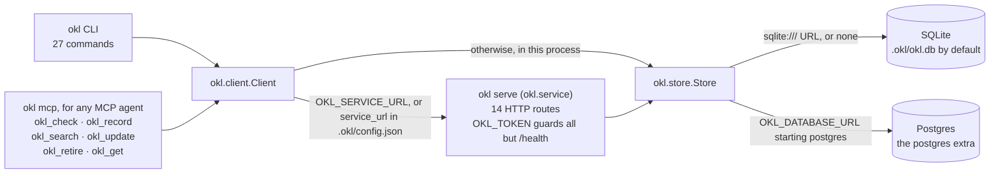
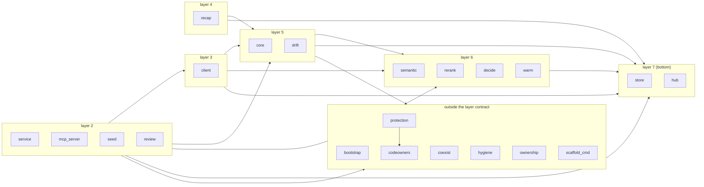

# How okl is built

Four diagrams of the project itself. The [overview and anatomy](../README.md) sheets explain
what okl does for you; these show how it is put together.

| Diagram | Shows | Kept current by |
|---|---|---|
| [What runs when](#what-runs-when) | each hook, tool and gate, the moment it fires and the command it runs | drawn; `ci/check-diagram-names.py` fails on a name the code no longer has |
| [A lesson's life](#a-lessons-life) | every state a lesson moves through, and the command that moves it | drawn; the same check |
| [Where lessons are stored](#where-lessons-are-stored) | the ways in, the client's choice of store, the backends | generated from the code |
| [The code's layers](#the-codes-layers) | the modules, the one-way import contract, and every import | generated from the code |

The generated ones are written by [`render_architecture.py`](render_architecture.py) from the
source and `pyproject.toml`, and `tests/test_architecture.py` fails the suite when the code
moves and they do not: run `python3 docs/render_architecture.py` to bring them back. The
drawn ones are Excalidraw files under `docs/architecture/`. Open the `.excalidraw` in
Excalidraw (excalidraw.com, or the VS Code extension), edit it, and export the `.svg` beside
it. `ci/check-diagram-names.py` reads each source and its render, and fails CI on any
command, flag, MCP tool, script or briefing mark they name that the code no longer has, on any
word shaped like a hook event that `hooks/hooks.json` does not register, and on a render whose
names differ from its source. It proves the names exist, not that the picture is right: a
change of behaviour under an unchanged name is still review's to catch. okl's previous
hand-drawn architecture diagram was retired after it was found wrong in four places that
nothing checked; these two are checked.

## What runs when

Six moments, left to right: three Claude Code hooks and the MCP tools inside a session, then
the pre-push hook and CI when the work leaves your machine. Each card names the event, the
script, the command it runs and whether it can stop you. Everything reads the store except
CI, which reads the snapshot `okl verify` and `okl export --drift` write from it.

## A lesson's life

Every state a lesson can be in, the command that moves it between them, and the mark a
briefing prints for each, so the agent knows how far to trust what it is told.

## Where lessons are stored

<!-- generated:storage -->

<!-- /generated:storage -->

## The code's layers

Higher layers import lower ones, never the reverse, and `|` separates siblings that must not
import each other. `lint-imports` enforces it in CI. An arrow is an import; the CLI's many
imports are drawn as one arrow to each group it reaches.

<!-- generated:layers -->
Layer 1 (top), `cli`, imports from every group below, so it is left out of the chart.

<!-- /generated:layers -->
